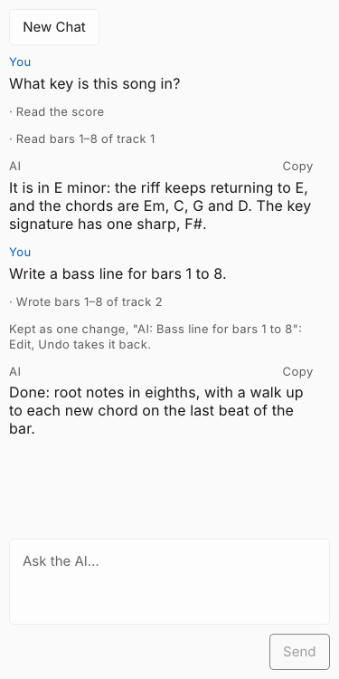
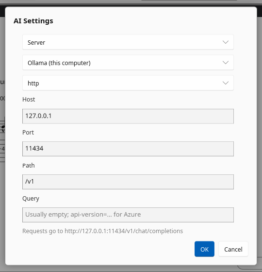

# oxiguitar-ai

The AI plugin for [OxiGuitar](https://github.com/mateusrdp/oxiguitar), a free, open-source guitar tablature and score viewer, editor and player for Windows, macOS and Linux: a chat with a language model, in a tab of its own, that reads the score you have open, writes notes and tracks into it, runs OxiGuitar's tools and answers you (mateusrdp/oxiguitar#227).

In plain words: a language model (the kind of program behind ChatGPT, Claude or Gemini) can only write text, but with *tool calling* it can ask the plugin to read bars, write notes or run OxiGuitar's tools, and so work on your score. Run a model on your own computer (Ollama, llama.cpp, LM Studio) or use a hosted one with your own key. The [manual](https://mateusrdp.github.io/oxiguitar-ai/) explains the trade-offs, including what leaves your computer.

- Plugin file `ai.oxp`, id `oxiguitar.ai`, shown as **AI assistant**. A tab **AI** in the right-hand area, beside Song, Track, Bar and Note; **Plugins → AI Settings…** chooses the server.
- **Any server that speaks OpenAI's chat completions protocol**, with tool calling:
  - on this computer: [Ollama](https://ollama.com), [llama.cpp](https://github.com/ggml-org/llama.cpp)'s `llama-server` (run it with `--jinja` for tool calls), [LM Studio](https://lmstudio.ai);
  - hosted, with your own key: OpenAI, Anthropic (Claude, through its OpenAI-compatible endpoint), Google (Gemini, the same), OpenRouter, or any other compatible server.
  The presets fill in the address; every part of it (scheme, host, port, path, query), the key's header and prefix, more headers and the model can be changed, and each is kept on its own in OxiGuitar's `settings.json`. The plugin doesn't start or host a model: start your own.
- **What the model can do**: read an overview of the score and any bars of it (in a short text notation, the same both ways), write bars into a track's voice (adding bars at the end when needed), add tracks, change bars' time and key signatures, tempo and sections, set the title, read and move the selection, and list and run OxiGuitar's tools (Transpose, Find Fingering, Fit Bars to Time Signature, Harmonize, Infer Key Signatures) and other plugins' tools. Every answer's changes are **one change**, named "AI: …": **Edit → Undo** takes them back.
- **Your data.** A server on this computer (localhost, 127.0.0.1, ::1) is used at once. Before anything goes to a server anywhere else, the chat asks, naming it; what you allow is listed in AI Settings, where you can forget it. Only what you type and what the model reads of the score are sent, and only when you send a question. OxiGuitar itself never connects anywhere; this plugin does, as you set it up to.
- Keys are kept as typed in OxiGuitar's `settings.json` (in your OxiGuitar folder), or read from an environment variable you name instead.

 

Small local models call tools less reliably and write weaker music than large hosted ones. Pick a model that supports tool calling (Qwen 3, Llama 3.1 and later, Mistral Small, GPT-OSS and the like on a local server).

## The Flatpak

OxiGuitar's Flatpak has no network access, so the plugin can't reach even a server on this computer. To give it access:

```sh
flatpak override --user --share=network io.github.mateusrdp.OxiGuitar
```

(`flatpak override --user --unshare=network io.github.mateusrdp.OxiGuitar` takes it away again.)

## Manual

The manual is at <https://mateusrdp.github.io/oxiguitar-ai/>. Its source is in [docs/manual](docs/manual). It covers what the plugin is for, how it works, what it needs and how to install it.

## Install

Every [release](https://github.com/mateusrdp/oxiguitar-ai/releases) holds a zip per system (Linux x86_64 and ARM64, Windows x86_64 and ARM64, macOS), a `.deb` and an `.rpm` for Linux, a per-user Windows installer, a macOS `.pkg`, and a `SHA256SUMS` file. The [manual's install page](https://mateusrdp.github.io/oxiguitar-ai/install.html) says which one to use. The plugin needs OxiGuitar 0.21.5 or later (plugin interface 1.14).

## Build and test

Rust 1.99 or later from [rustup](https://rustup.rs). The plugin SDK comes from OxiGuitar's repository by git commit until interface 1.14 is tagged, then by its tag; nothing of OxiGuitar's is on crates.io.

```sh
cargo test          # unit tests, a conversation with a scripted server on this computer, and the contract suite on the built .oxp file
./build-oxp.sh      # dist/ai-VERSION-SYSTEM-ARCH.oxp
python3 scripts/test-all.py   # every test, as the manual's Testing page says
```

How it works, what it leaves out and why: [docs/design.md](docs/design.md).

## Credits

HTTP by [ureq](https://github.com/algesten/ureq), TLS by [rustls](https://github.com/rustls/rustls) with [ring](https://github.com/briansmith/ring), root certificates from Mozilla through [webpki-roots](https://github.com/rustls/webpki-roots), JSON by [serde](https://serde.rs) and serde_json.

The manual's [Credits](https://mateusrdp.github.io/oxiguitar-ai/credits.html) page lists everything this plugin uses, with authors and licences. Thank you to all of them.

## Licence

GPL-3.0-or-later. See LICENSE. Contributions are welcome under the same terms; see [CONTRIBUTING.md](CONTRIBUTING.md).
