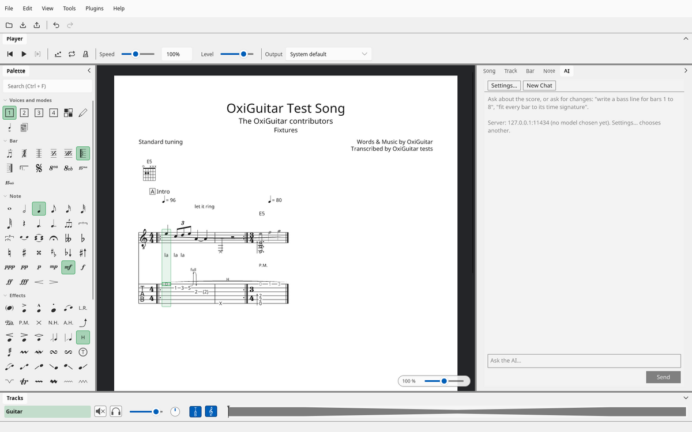

# AI assistant plugin

This plugin adds a chat with a language model, in a tab of its own on the right of the window. The model can read the score you have open, write notes and tracks into it, run OxiGuitar's tools, and answer your questions.

It is an early plugin, built partly to find what the plugin interface was still missing. The package repositories don't suggest it, so you install it on purpose.

**Plugins → AI Settings…** chooses the server. [How to use it](use-cases.md) walks through it.

## Language models, in a few words

A **language model** (an LLM, the kind of program behind ChatGPT, Claude or Gemini) is a very large neural network trained on huge amounts of text to predict what comes next. Given a conversation, it writes a reply. It has no hands of its own: on its own it can only produce text.

**Tool calling** gives it hands. Along with your question, the plugin tells the model which actions it may take ("read bars 1 to 8 of track 2", "write these notes into the bass track", "run Transpose") and how to ask for them. The model answers with a request for one of those actions, the plugin carries it out in OxiGuitar and sends back the result, and the model goes on until it has an answer for you. That is how it can read and change your score.

Models run either **on your own computer**, through a free program such as Ollama, llama.cpp or LM Studio, or **on a company's servers** (OpenAI, Anthropic, Google and others), which you reach with an account and a key. Most of them, local or hosted, accept requests in the same shape, OpenAI's *chat completions* format, so one plugin talks to all of them.

A local model keeps everything on your computer and costs nothing per question, but needs a capable computer and is usually smaller and less reliable with tools. A hosted model is stronger and needs no hardware, but your question and the parts of the score it reads leave your computer, and you pay for what you use.

## Music and language models

A language model doesn't hear. It reads a score written out as text and writes music back the same way, so it is better at structure (adding a bass line that follows the chords, filling a drum part, transposing, fixing bars that don't add up) than at taste. Treat what it writes as a suggestion: listen to it, and undo it if it isn't right.
