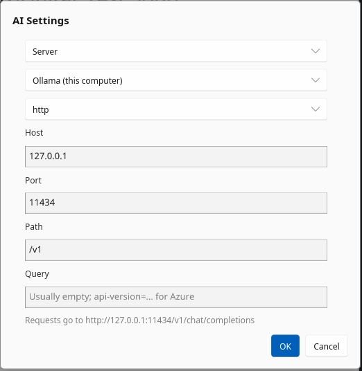
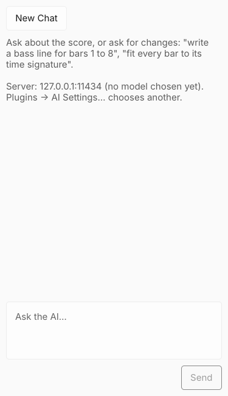

# How to use it

## Set it up

1. Start a model server, or get a key for a hosted one (see [Which model](#which-model) below).
2. Choose **Plugins → AI Settings…**.
3. Pick a preset under **Server**, such as Ollama on this computer or a hosted service, and change what you need: the host, the port, the key and the model.



4. Click **OK**.

## Ask

Open the **AI** tab on the right, type in the box at the bottom and click **Send**. Ask about the song, or for a change: "write a bass line for bars 1 to 8", "fit every bar to its time signature", "transpose the whole song down a whole step".



**New Chat** starts over. Everything the model changes in one answer is a single step called "AI: …", so **Edit → Undo** takes it all back.

## What you can do with it

- Ask for music. The model can write bars into a track's voice, add tracks, change time and key signatures, tempo and sections, and set the title.
- Ask about a score. It reads an overview of the song and any bars of it.
- Hand it routine work. It can run OxiGuitar's tools, such as Transpose, Find Fingering, Fit Bars to Time Signature, Harmonize and Infer Key Signatures, and other plugins' tools.

Everything the model changes in one answer is one change, named "AI: …". **Edit → Undo** takes it all back.

## Which model

Any server that speaks OpenAI's chat completions protocol, with tool calling. On your own computer, that means Ollama, llama.cpp's `llama-server` (start it with `--jinja`) and LM Studio. Hosted, with your own key, it means OpenAI, Anthropic, Google, OpenRouter, or any compatible server. The plugin doesn't start a model for you.

Small local models call tools less reliably and write weaker music than large hosted ones. Pick a model that supports tool calling.

## Your data

A server on your own computer is used at once. Before anything goes to a server anywhere else, the chat asks, naming the server. Only what you type and what the model reads of the score is sent, and only when you send a question. OxiGuitar itself never connects anywhere. This plugin does, as you set it up.

Keys are stored as typed in OxiGuitar's `settings.json`, or read from an environment variable you name instead.

## In the Flatpak

OxiGuitar's Flatpak has no network access, so the plugin can't reach even a server on your own computer. To allow it:

```sh
flatpak override --user --share=network io.github.mateusrdp.OxiGuitar
```

To take it away again, use `--unshare=network`.
